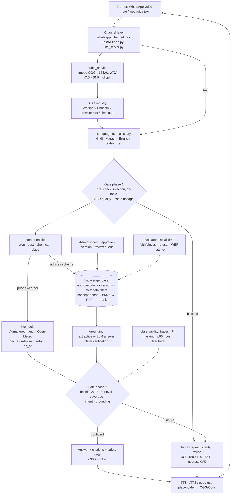

# Kisan Vani – Voice-First Multilingual Agricultural Assistant (Hindi · Marathi)

IA Activity-2 prototype, built from the Sagveek Technologies blueprint. A farmer sends a **voice note or text** in Hindi or Marathi; the assistant answers **only from approved, cited documents** or from **live mandi / weather tools** (with a "data as of" date), and **refuses safely** – handing off to Kisan Call Centre (**1800-180-1551**) or the local KVK – when it is not sure.

> **Honesty note.** The prototype runs fully offline with no API keys. The speech recogniser, TTS voice, mandi prices and weather are **clearly labelled simulations** unless you switch the real backends on (see *Optional upgrades*). The 27 seed documents are short demo summaries written for this project, not official ICAR/KVK text. Verify before any real deployment.

## 1. Architecture



Both servers (`app.py` FastAPI and `lite_server.py` stdlib) mount the same `handlers.ROUTES` table, so behaviour is identical.

## 2. Model and technology trade-offs

| Layer | Chosen for prototype | Production option | Why / trade-off |
|---|---|---|---|
| ASR (speech → text) | Simulated tag reader + browser Web Speech hint | Whisper-large-v3 / Bhashini (encoder-decoder) | Whisper handles Hindi/Marathi but needs GPU and is slower; Bhashini is government-hosted and free but rate-limited. Browser speech needs no server but is online-only. |
| Embeddings (encoder-only) | Hashing **concept-id** embedder (offline, cross-lingual) | BGE-M3 (`AGRI_EMBEDDER=bge-m3`) | Concept ids work offline and map हिंदी/मराठी/English to the same id; BGE-M3 is stronger on open text but needs 2 GB and a model download. |
| Retrieval | **Hybrid**: dense + BM25 fused with RRF (k=60) | Same + vector DB (pgvector / Qdrant) | Dense alone misses exact names (mancozeb, PBW); BM25 alone misses Hindi↔Marathi. RRF needs no tuning. A vector DB is needed only beyond ~100k chunks. |
| Reranker | Lexical coverage reranker | Cross-encoder (`AGRI_RERANKER=cross-encoder`) | Cheap and explainable; a cross-encoder adds ~100 ms and some accuracy. |
| Answer generation (decoder-only) | **Extractive** (only sentences from approved text) | LLM via `register_generator` with the grounded prompt | Extractive cannot hallucinate; an LLM reads better but must pass claim verification, else we fall back to extractive. |
| Translation (encoder-decoder) | Glossary protect/restore + NLLB hook | NLLB-200 / IndicTrans2 | Glossary keeps terms like "फेरोमोन ट्रैप" intact; MT quality drifts on agronomy terms, so KB is stored natively in each language. |
| TTS | gTTS → edge-tts → silent placeholder of correct length | Bhashini TTS / Azure Neural | gTTS is free but online; neural voices sound better and cost money. |
| Vector DB | In-process index + JSON state | pgvector / Qdrant | No infra for a demo; swap behind `KnowledgeBase`. |
| Evaluation | Own harness, 74 questions, 5 categories | Same + expert-labelled field set | Fast and reproducible; the set is small and written by us. |

## 3. Confidence and refusal logic (with Kisan Call Centre / KVK fallback)

Phase 1, `pre_check`, runs **before retrieval**: prompt-injection, off-topic or speculative questions ("who wins IPL", price prediction), unsafe dosage requests, and poor speech recognition.
Phase 2, `decide`, runs **after** retrieval and answer generation and combines five signals:

| Signal | Weight | Minimum |
|---|---|---|
| ASR confidence | 0.20 | 0.60 |
| Retrieval score | 0.35 | 0.35 |
| Evidence coverage (does the evidence mention the crop / pest / chemical asked about?) | 0.30 | 0.60 |
| Intent confidence | 0.05 | – |
| Grounding (claims found in cited text) | 0.10 | 0.90 |
| **Overall** | | **0.55** |

Actions: `answer` · `ask_repeat` (bad audio) · `ask_clarify` (crop missing, or transcript to confirm) · `refuse`. Every decision carries reason codes shown in the UI.

**Hard safety rules (not score-based, so a high score cannot override them):**
- A dose answer needs an approved chunk that covers *both* the crop and the chemical.
- "Double the dose", mixing chemicals, or a chemical not in approved sources → refuse.
- Chemical answers add a safety note ("read the label, gloves and mask, confirm with KVK").
- Region filter: Maharashtra-only advice is never served for Delhi.
- Unapproved or superseded documents are never retrieved.

**Refusal hand-off (Hindi):** "मुझे इस सवाल का भरोसेमंद जवाब नहीं मिला। कृपया किसान कॉल सेंटर 1800-180-1551 पर कॉल करें या अपने नज़दीकी कृषि विज्ञान केंद्र (KVK) से संपर्क करें।" Marathi and English versions are in `confidence_gate.MESSAGES`.

## 4. Live mandi and weather: "data as of"

Every tool result carries `as_of`, `source`, `mode` (live or demo-feed), `from_cache`, `stale`, and the spoken/written answer always says it:
- Hindi: "आंकड़े 21-11-2026 तक के हैं।" Marathi: "आकडेवारी 21-11-2026 पर्यंतची आहे." English: "Data as of 21-11-2026."
- Mandi: Agmarknet via data.gov.in (`AGRI_LIVE=1`, `DATA_GOV_API_KEY`), 15-min cache, token-bucket rate limit, exponential-backoff retry, stale-cache fallback marked `stale`. Sunday queries use the latest market day (Saturday).
- Weather: Open-Meteo 3-day forecast plus rule-based advisories (heavy rain, dry spell, heat).
- **If the live source fails, the answer says so. It never invents numbers.** Without `AGRI_LIVE` the feed is labelled "DEMO FEED".

## 5. Examples

| Language | Farmer says | Result |
|---|---|---|
| Marathi | माझ्या कापसाची पाने पिवळी पडत आहेत, काय करावे? | Answer from the KVK cotton nutrition note, cited, with confidence badge |
| Hindi | मेरे कपास में गुलाबी सुंडी आ गई है, क्या करूं? | Pheromone traps (5/ha), threshold 8 moths/trap, cited (ICAR-CICR demo summary) |
| Hindi | आज लासलगांव में प्याज का भाव क्या है? | Live-tool card: min/modal/max ₹/quintal, "data as of" date |
| Marathi | पीक विमा योजनेचा प्रीमियम किती आहे? | Scheme answer from the PMFBY document |
| Hindi | टमाटर में झुलसा रोग के लिए मैंकोज़ेब कितना डालूं? | 2.5 g/L from the approved doc **plus** safety note |
| Marathi | कापसावर औषधाचे प्रमाण दुप्पट केले तर चालेल का? | **Refuse** (unsafe) + KCC/KVK |
| Marathi | ऊसावरील रोग (sugarcane is not in the KB) | **Refuse** instead of answering from a wrong crop's document |
| Hindi | noisy audio (confidence 0.38) | **Ask to repeat** |

## 6. Evaluation (`python evaluator.py`)

74 questions in 5 categories (answerable, live tool, chemical/dosage, low-confidence/ambiguous, unanswerable/adversarial), plus 17 voice notes end to end.

| Metric | Result | Target |
|---|---|---|
| Retrieval Recall@5 / MRR | 100% / 1.00 | ≥ 85% |
| Faithfulness (claims supported by evidence) | 100% | ≥ 90% |
| Safe-refusal accuracy | 100% | ≥ 95% |
| False-refusal rate | 0% | ≤ 10% |
| Hallucination-detection rate (injected bad claims caught) | 100% | – |
| Voice end-to-end decision accuracy | 17 / 17 | – |
| Projected voice latency p95 (real ASR + TTS) | 4.1 s | ≤ 8 s |
| ASR WER on fixture (hi / mr) | 0.164 / 0.227 | reported only |

**Limitations, stated plainly:** the eval set was written by the same author as the system, so 100% shows the system is consistent with its own tests, not that it is field-ready. The WER and chrF figures come from a small illustrative fixture, not a real ASR benchmark. Language-id for Marathi uses heuristics tuned on these examples. Measured latency (about 20 ms) excludes real models; the 4.1 s figure is a projection from a budget table.

## 7. Run it

Requires Python 3.10+. `ffmpeg` is optional (OGG/Opus decoding falls back to WAV-only without it).

**Windows (PowerShell)**
```powershell
cd agri-assistant
python -m venv .venv
.\.venv\Scripts\Activate.ps1
pip install -r requirements.txt
python -m unittest discover -s tests          # expect: OK (skipped=0..2)
python evaluator.py                           # expect: all targets PASS
python app.py                                 # FastAPI + UI on http://127.0.0.1:8000/ui
```
**Ubuntu / WSL**
```bash
cd agri-assistant
sudo apt install -y python3-venv ffmpeg
python3 -m venv .venv && source .venv/bin/activate
pip install -r requirements.txt
python -m unittest discover -s tests
python evaluator.py
uvicorn app:app --host 127.0.0.1 --port 8000
```
**No pip access?** `python lite_server.py` serves the same API and UI using only the standard library.

**Verify:** open http://127.0.0.1:8000/ui · `curl http://127.0.0.1:8000/health` · API docs at http://127.0.0.1:8000/docs (FastAPI only).
```bash
curl -s -X POST http://127.0.0.1:8000/query/text -H "Content-Type: application/json" \
  -d '{"text":"गहू पेरणी कधी करावी?","tts":false}'
```
Port busy? `PORT=8080 python app.py` (PowerShell: `$env:PORT=8080`).

### Optional upgrades (environment variables)
| Variable | Effect |
|---|---|
| `AGRI_LIVE=1`, `DATA_GOV_API_KEY` | Real Agmarknet mandi prices and Open-Meteo weather |
| `AGRI_ASR_BACKEND=whisper` / `bhashini` | Real speech recognition (install `faster-whisper`) |
| `AGRI_TTS_BACKEND=gtts` / `edge` | Real spoken replies |
| `AGRI_EMBEDDER=bge-m3`, `AGRI_RERANKER=cross-encoder` | Neural retrieval |
| `AGRI_TOKENS="admin:A1,reviewer:R1,analyst:N1"` | Turns on role-based access; send `X-Admin-Token` |
| `WHATSAPP_VERIFY_TOKEN`, `WHATSAPP_TOKEN`, `WHATSAPP_PHONE_NUMBER_ID`, `WHATSAPP_APP_SECRET`, `AGRI_WA_CONSENT` | WhatsApp Cloud API (live HTTP path is untested) |

## 8. Risks and mitigations

| Risk | Mitigation |
|---|---|
| Wrong pesticide dose harms crops or people | Hard dose rules, approved-source-only, safety note, KVK confirmation |
| Hallucinated advice | Extractive answers, claim verification, grounding ≥ 0.90 else fallback |
| Dialects and noisy fields mis-transcribed | ASR confidence gate, ask-to-repeat, echo transcript for medium confidence |
| Stale or wrong prices | `as_of` on every result, cache TTL, stale label, no fake fallback |
| Outdated advisories | Versioning, supersede, `review_due` after ~18 months |
| Prompt injection | Pattern detection before retrieval; KB text never treated as instructions |
| Privacy | Consent flow, phone masking, user hashing, "delete my data" command, audio auto-delete after 1 h |
| Unauthorised edits | Admin approval workflow, RBAC tokens, review queue |

## 9. Future scope
Leaf-photo disease detection (vision model feeding the same gate) · IVR / missed-call for feature phones · soil-health-card and crop-insurance claim guidance · offline edge mode (small ASR + local KB on a village kiosk) · more languages (Gujarati, Telugu) · expert-labelled field evaluation with KVK scientists.

## 10. Project layout
`config.py` settings · `glossary.py` concepts/language-id · `audio_service.py` audio+ASR+TTS · `knowledge_base.py` hybrid retrieval · `live_tools.py` mandi/weather · `confidence_gate.py` · `grounding.py` · `assistant_pipeline.py` · `whatsapp_channel.py` · `handlers.py` routes · `app.py` FastAPI · `lite_server.py` stdlib · `evaluator.py` · `ui_demo.html` · `tests/` · `docs/`

More: [docs/DEMO_SCRIPT.md](docs/DEMO_SCRIPT.md) · [docs/REQUIREMENTS_CHECKLIST.md](docs/REQUIREMENTS_CHECKLIST.md) · [docs/API.md](docs/API.md) · [docs/DEPLOYMENT.md](docs/DEPLOYMENT.md) · [docs/DATA_SOURCE_REGISTER.md](docs/DATA_SOURCE_REGISTER.md) · [docs/USER_GUIDE.md](docs/USER_GUIDE.md)
